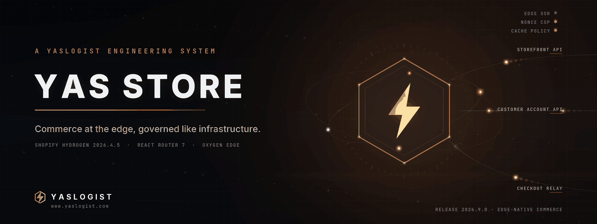
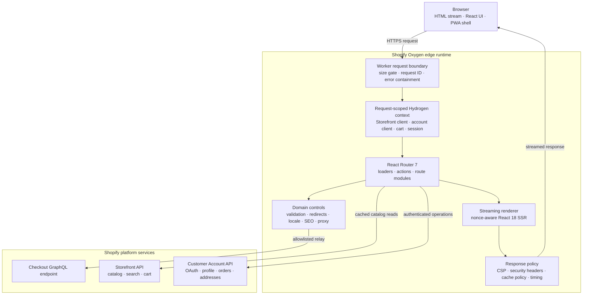
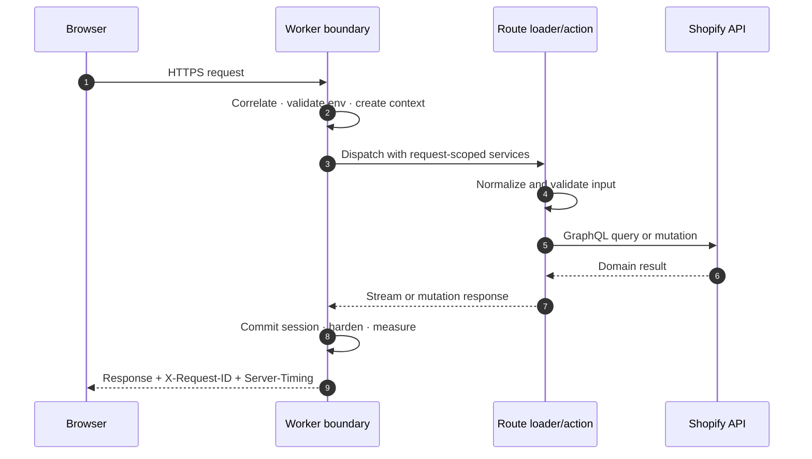
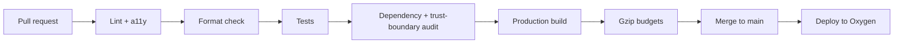
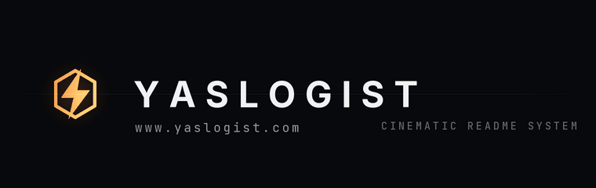

<div align="center">
  
  <sub>Looping cinematic hero · 1920×720 · rendered for this repository · static poster at <a href="./assets/readme/yaslogist-hero.png"><code>assets/readme/yaslogist-hero.png</code></a></sub>
</div>

<div align="center">

# YAS STORE

**TECHNICAL WHITEPAPER · RELEASE 2026.9.0**

### The production reference architecture for edge-native Shopify commerce

**Streaming storefront delivery, a centralized zero-trust boundary, and measurable quality gates — built on Shopify Hydrogen and designed for Oxygen.**

[](https://github.com/YASLOGIST/as-store-v1yas-frontend/actions/workflows/ci.yml)
[](https://nodejs.org)
[](https://shopify.dev/docs/custom-storefronts/hydrogen)
[](https://reactrouter.com)
[](./LICENSE)

[**The System**](#01--the-system) · [**Capabilities**](#02--core-capabilities) · [**Architecture**](#03--engineering-architecture) · [**Blueprint**](#04--system-blueprint) · [**Execution**](#05--execution-intelligence) · [**Ignition**](#06--ignition) · [**Deep Access**](#07--deep-system-access) · [**Status**](#08--engineering-status) · [**YASLOGIST**](#09--yaslogist)

</div>

<p align="center">
  
</p>

## 01 / THE SYSTEM

> **Executive position**
>
> YAS Store is not a theme with an API attached. It is a server-rendered commerce system in which delivery, security, observability, search, cart state, account state, SEO, and accessibility are treated as one operating model. The result is a storefront foundation that can move from evaluation to production without a second architecture pass.

YAS Store is engineered for teams that need Shopify's commerce platform without surrendering control of frontend performance, interface quality, or request security. React is streamed from the edge; Shopify clients and signed sessions are created per request; mutations cross explicit validation boundaries; and every production change is evaluated against tests, security checks, and gzip budgets.

| Business requirement | Engineering response | Practical outcome |
|---|---|---|
| Fast first render | Edge SSR, streamed HTML, deferred non-critical data, route-level code splitting | Useful UI arrives before every downstream query has completed |
| Safe commerce mutations | Same-origin enforcement, bounded inputs, validated Shopify IDs, local-only commerce redirects | Cart operations fail closed at the trust boundary |
| Predictable operations | Correlation IDs, `Server-Timing`, structured privacy-safe logs, explicit cache policy | Incidents can be traced without logging customer input or credentials |
| Durable acquisition | Canonicals, OpenGraph/Twitter metadata, JSON-LD, sitemaps, robots controls | Product and editorial surfaces are machine-readable and crawlable |
| Controlled frontend growth | CI-enforced JavaScript and CSS gzip ceilings | Performance regressions become build failures, not backlog items |
| Inclusive global UX | Semantic controls, focus-managed drawers, live regions, RTL-aware document shell | Keyboard, assistive-technology, reduced-motion, and RTL use cases are first-class |

**Reading the hero.** The opening sequence is a compact expression of the system, not decorative branding: the **hexagonal enclosure** is the bounded trust perimeter; the **lightning core** (the repository's official mark) is edge execution and low-latency commerce; the **orbital paths** are Shopify services moving through a stable request boundary; the three **converging signal feeds** are the Storefront API, the Customer Account API, and the allowlisted checkout relay. The single amber signal on graphite follows the repository's own *Volt* design language — visual energy belongs at the experience layer, complexity remains contained behind explicit technical boundaries.

<p align="center">
  
</p>

## 02 / CORE CAPABILITIES

### Commerce and customer experience

| Capability | Implementation | Value delivered |
|---|---|---|
| Product discovery | Full and predictive search across products, collections, pages, articles, and query suggestions | Faster paths from intent to inventory |
| Product merchandising | Variant selection, availability, compare-at pricing, sale/sold-out states, image treatment, breadcrumbs | Decision-critical product data remains visible and actionable |
| Collection merchandising | Server-side sort plus Storefront faceted filters (availability, price, type, vendor) with chips, counts, and a dedicated empty state | Every state is a URL and works without client JavaScript |
| Quick add | Product-card add-to-cart with optimistic interaction and valid non-nested controls | Lower-friction conversion from listing surfaces |
| Cart management | Add, update, remove, discount, gift card, buyer identity, cart permalinks | Complete cart lifecycle without abandoning the storefront shell |
| Customer accounts | OAuth login, profile, addresses, order history, order detail, logout | Shopify-managed identity with a first-party frontend experience |
| Content commerce | Blogs, articles, CMS pages, policies, collections, and products | Editorial and transactional journeys share one delivery system |
| Progressive sharing | Native share sheet, then clipboard, then selectable-link fallback | Share behavior degrades cleanly across browsers |
| PWA shell | Manifest, standard and maskable icons, theme metadata | App-like presentation without making installation a dependency |

### Experience quality

| Capability | Implementation | Operational standard |
|---|---|---|
| Streaming states | Shape-matched skeletons and deferred below-the-fold data | Non-critical upstream failure does not block the primary page |
| Navigation feedback | Visual progress plus polite live-region status | Route changes remain perceivable without delaying navigation |
| Keyboard interaction | `/` search focus, `Ctrl/⌘ + K` predictive search, `Esc` close/restore | Primary discovery paths work without a pointer |
| Focus management | Trapped dialogs, scroll lock, focus restoration, unique labels | Drawers behave as accessible modal interfaces |
| Motion preferences | `prefers-reduced-motion` fallbacks across decorative movement | Animation is enhancement, never a usability requirement |
| Locale shell | Validated `lang`; automatic RTL direction for recognized locales | Document semantics adapt safely to locale context |
| Error states | Distinct guidance, no-results, recoverable upstream, 404, and production-safe 500 views | Failures are explicit without exposing internals |
| Responsive design | Fluid type, spacing, containers, and touch-oriented controls | One system scales from mobile to ultrawide displays |

### Platform capabilities

| Domain | Capability | Implementation evidence |
|---|---|---|
| Security | Centralized response hardening and nonce-based CSP | `server.js`, `app/entry.server.jsx`, `app/lib/http.js` |
| Session integrity | Signed `HttpOnly`, `SameSite=Lax`, secure `__Host-` cookie in HTTPS; multi-secret rotation | `app/lib/session.js`, `app/lib/env.js` |
| Proxy isolation | POST-only checkout relay, validated domain/version, 256 KiB body limit, header allowlist | `app/lib/proxy.js` |
| Search safety | NFKC normalization, control-character removal, 100-code-point term limit, bounded result count | `app/lib/validation.js` |
| Commerce safety | Shopify resource-ID checks, maximum 25 lines, quantity ceiling of 99 | `app/lib/validation.js` |
| SEO | Canonicals, social metadata, Product/Collection/Article/Breadcrumb/WebSite JSON-LD | `app/lib/seo.js` |
| Crawl control | Generated `robots.txt`, sitemap index, paginated resource sitemaps, `noindex` for private/utility surfaces | `app/routes/[robots.txt].jsx`, sitemap routes |
| Observability | Validated correlation IDs, `Server-Timing`, minimal structured logs | `app/lib/http.js` |
| Quality automation | Lint, a11y, formatting, tests, dependency audit, build, bundle budgets | `.github/workflows/ci.yml` |
| Type safety | Storefront and Customer Account GraphQL declarations plus React Router type generation | generated `.d.ts` files, `npm run codegen` |

<p align="center">
  
</p>

## 03 / ENGINEERING ARCHITECTURE

### Responsibility model

| Layer | Owns | Deliberately does not own |
|---|---|---|
| `server.js` | Request correlation, declared 1 MiB body rejection, context creation, session commit, Shopify redirects, safe failure response | Route-specific business behavior |
| `app/lib/http.js` | Security headers, sensitive-route cache policy, origin checks, safe redirects, timing, sanitized request logs | Rendering and Shopify queries |
| `app/lib/context.js` | Runtime configuration validation, request-scoped Shopify clients, cache, cart, and signed session | Global mutable application state |
| React Router route modules | Page data, mutations, metadata, response semantics | Cross-cutting transport policy |
| `app/lib/*` domain modules | Input contracts, proxy isolation, navigation safety, locale, search state, SEO schemas | UI composition |
| React component layer | Progressive enhancement, accessibility, analytics events, interaction state | Secret handling or direct privileged API access |
| Shopify services | Catalog, customer identity, cart persistence, checkout | Storefront presentation and edge policy |

### Architectural invariants

- **No shared request state.** Shopify clients and session state are scoped to a single request.
- **No unbounded commerce input.** Search terms, result limits, cart lines, quantities, codes, IDs, and proxy bodies have explicit contracts.
- **No open redirects.** User-influenced destinations resolve only to same-origin paths.
- **No public caching of customer state.** Account, cart, discount, API, and cookie-setting responses are forced to `private, no-store`.
- **No stream buffering for hardening.** Response streams are rewrapped so policy headers remain writable while progressive delivery is preserved.
- **No sensitive diagnostic payloads.** Logs omit cookies, tokens, query strings, headers, customer input, and stack details.
- **No silent budget drift.** CI fails when JavaScript or CSS crosses its gzip ceiling.

For the behavioral specification and evidence map, see [`docs/ARCHITECTURE.md`](./docs/ARCHITECTURE.md).

## 04 / SYSTEM BLUEPRINT



## 05 / EXECUTION INTELLIGENCE

Every request follows the same path:

1. **Identify** — accept a syntactically safe upstream request ID or issue a new UUID.
2. **Reject early** — requests declaring a body larger than 1 MiB receive `413` before route dispatch.
3. **Validate configuration** — required domains, tokens, and session secrets fail fast without echoing secret values.
4. **Create isolated context** — cache, signed session, Storefront API, Customer Account API, and cart helpers are instantiated for that request.
5. **Dispatch** — React Router selects a loader or action; domain modules validate untrusted input before Shopify receives it.
6. **Render or mutate** — catalog reads use Shopify caching; sensitive operations are explicitly private and non-cacheable.
7. **Stream** — React 18 returns a nonce-aware HTML stream. Bots wait for complete rendering; browsers can receive progressive output.
8. **Harden and observe** — the boundary applies headers without buffering the stream, emits timing, and records a privacy-safe request event when required.



<p align="center">
  
</p>

## 06 / IGNITION

### Prerequisites

- Node.js **22 or newer**, npm **10.x**
- A Shopify store with the **Headless** sales channel
- Storefront API credentials; Customer Account credentials are optional unless account flows are required

### Install and start

```bash
git clone https://github.com/YASLOGIST/as-store-v1yas-frontend.git
cd as-store-v1yas-frontend
npm ci

cp .env.example .env
openssl rand -base64 32   # use this output for SESSION_SECRET

npm run dev
```

### Environment contract

| Variable | Required | Purpose |
|---|:---:|---|
| `PUBLIC_STORE_DOMAIN` | Yes | Shopify store hostname, for example `store.myshopify.com` |
| `PUBLIC_STOREFRONT_API_TOKEN` | Yes | Public Storefront API access token |
| `PUBLIC_CHECKOUT_DOMAIN` | Yes | Validated checkout hostname |
| `SESSION_SECRET` | Yes | Cookie signing secret, minimum 32 characters |
| `PUBLIC_STORE_LANGUAGE` | No | Shopify language enum; defaults to `EN` (for example `AR`, `PT_BR`) |
| `PUBLIC_STORE_COUNTRY` | No | Shopify two-letter country enum; defaults to `US` |
| `PUBLIC_STORE_MARKETS` | No | Allow-listed `LANGUAGE-COUNTRY` values for the market switcher |
| `PUBLIC_FEATURE_*` | No | Independent public kill switches documented in `.env.example` |
| `PUBLIC_STOREFRONT_ID` | No | Storefront public ID for web pixel analytics |
| `PUBLIC_CUSTOMER_ACCOUNT_API_CLIENT_ID` | No | Enables Customer Account API flows |

For zero-downtime rotation, use `NEW_SECRET,PREVIOUS_SECRET` — the first value signs new cookies while remaining values keep validating existing ones. Runtime validation reports missing or malformed configuration by variable name and never echoes values.

### Toolchain verification without a store

```bash
npm run check        # lint · format · 122 tests · dependency audit
npm run build:ci     # credential-free Hydrogen production build
npm run check:performance   # enforce gzip budgets on the built output
```

<p align="center">
  
</p>

## 07 / DEEP SYSTEM ACCESS

<details>
<summary><strong>Core workflows</strong> — catalog, search, cart, account, delivery</summary>

| Workflow | Entry point | Critical path | Failure and cache policy |
|---|---|---|---|
| Catalog render | `GET /products/:handle` or collection/content route | Worker → loader → Storefront API → streamed SSR | Catalog reads may cache; missing resources return route-level 404 |
| Predictive search | `GET /search?predictive&q=…` | Normalize term → clamp limit → Storefront API → typed result buckets | Empty and upstream-error states remain distinct; search is `noindex` |
| Cart mutation | `POST /cart` | Same-origin check → parse intent → validate input → Hydrogen cart mutation | Invalid input returns `400`, foreign origin `403`; response is private/no-store |
| Account authentication | `GET /account/login` and OAuth callback | Customer Account authorize → callback → authenticated account client | OAuth errors remain within the account flow; account responses are private |
| Checkout relay | `POST /api/:version/graphql.json` | Origin check → method/version/domain/body validation → allowlisted fetch | No inbound cookies or authorization headers are forwarded; no-store response |
| Edge delivery | Any document request | Context → route data → React stream → security headers | Production exceptions become generic `500`; stack details remain server-side |
| Release | Pull request or push to `main` | Install → static gates → tests → audit → build → bundle budgets → Oxygen | A failed gate blocks delivery; only the default branch deploys |

**Catalog conversion property** — the buy path depends on product and variant truth, not on footer content or other deferred data. Filter state lives only in the query string (`?sort=`, repeated `?filter=`); pagination cursors are dropped whenever the result set changes, so a cursor can never outlive the set it indexed.

**Search contract** — Unicode NFKC normalization, control removal, whitespace collapse, 100-code-point cap; predictive limits bounded to `1…10`; exactly one of four coherent states (initial guidance, results, no matches, recoverable upstream failure) announced through a single polite live region.

**Cart integrity property** — a request can mutate only supported cart operations with bounded Shopify identifiers and quantities; redirects cannot escape the storefront origin.

**Account trust property** — the storefront integrates Shopify-managed identity without implementing a parallel credential system.



</details>

<details>
<summary><strong>Security controls</strong> — transport, execution, sessions, inputs, caching</summary>

| Boundary | Control |
|---|---|
| Transport | HSTS on production HTTPS; deny framing; MIME sniff protection; strict referrer policy |
| Content execution | Hydrogen-generated nonce CSP; nonce propagated through React rendering and scripts |
| Browser capabilities | Restrictive permissions policy, opener policy, origin-agent clustering |
| Mutation origin | Foreign `Origin` or cross-site browser fetch metadata rejected with `403` |
| Sessions | Signed, HTTP-only, same-site cookies; secure `__Host-` naming on HTTPS; secret rotation |
| Inputs | Explicit bounds and resource patterns for search, cart, commerce codes, API versions, and domains |
| Redirects | Relative same-origin paths only; protocol-relative, foreign, backslash, and control-character targets rejected |
| Checkout proxy | POST-only, 256 KiB body ceiling, strict outbound header allowlist, narrow response-header forwarding |
| Caching | Sensitive paths and cookie-setting responses forced to `private, no-store, max-age=0` |
| Failure disclosure | Generic production error body; no stack trace or thrown payload serialization |
| Diagnostics | Path-only structured logs with request ID, method, status, duration, and error class name |

Security behavior is pinned by executable tests in `app/lib/http.test.js`, `proxy.test.js`, and `validation.test.js`. Report vulnerabilities through [`SECURITY.md`](./SECURITY.md).

</details>

<details>
<summary><strong>Performance budgets</strong> — measured on the production output, enforced in CI</summary>

[`scripts/check-bundle.mjs`](./scripts/check-bundle.mjs) measures the production output itself — not source estimates.

| Asset class | Gzip ceiling | Measured (2026-10-10, this branch) |
|---|---:|---:|
| Largest JavaScript asset | **50 KiB** | 44.6 KiB |
| All client JavaScript | **150 KiB** | 149.9 KiB |
| All CSS | **12 KiB** | 12.0 KiB |

The implementation reinforces these budgets with route splitting, external assets (`assetsInlineLimit: 0`), CSS splitting, cached catalog reads, deferred non-critical queries, and streamed SSR.

</details>

<details>
<summary><strong>Search and crawl model</strong> — JSON-LD, metadata, robots, sitemaps</summary>

- Product, collection, article, breadcrumb, and website data are emitted as schema.org JSON-LD.
- Public routes receive canonical, OpenGraph, and Twitter metadata. The same `public/og-image.jpg` served by `app/root.jsx` as `og:image` represents the project on GitHub, in pull requests, and on external link cards.
- `robots.txt`, a sitemap index, and paginated resource sitemaps are generated at the edge.
- Cart, search, and account surfaces are marked `noindex` so crawl budget stays focused on public content.

</details>

<details>
<summary><strong>Route surface</strong> — every implemented route</summary>

| Surface | Routes |
|---|---|
| Home and catalog | `/`, `/products/:handle`, `/collections`, `/collections/:handle`, `/collections/all` |
| Discovery | `/search`, predictive search through the same loader |
| Cart and promotions | `/cart`, `/cart/:lines`, `/discount/:code` |
| Content | `/blogs`, `/blogs/:blog`, `/blogs/:blog/:article`, `/pages/:handle`, `/policies/*` |
| Account | `/account/*`, `/account/login`, `/account/authorize`, `/account/logout` |
| Platform | `/api/:version/graphql.json`, `/robots.txt`, `/sitemap.xml`, `/sitemap/:type/:page.xml`, `/health.json` |

A deployed worker exposes `GET /health.json` for readiness probes; it returns only `{"status":"ok"}` and is never cacheable.

</details>

<details>
<summary><strong>Repository anatomy & documentation</strong></summary>

```text
.
├── app/
│   ├── components/            UI, commerce controls, accessibility primitives
│   ├── graphql/               Customer Account API operations
│   ├── lib/                   Trust boundaries, domain rules, SEO, sessions
│   ├── routes/                File-based storefront and API routes
│   ├── styles/                Reset and Volt design system
│   ├── tests/                 Route-level commerce flow contracts
│   ├── entry.client.jsx       Browser hydration entry
│   ├── entry.server.jsx       Streaming SSR and nonce CSP
│   └── root.jsx               Document shell and shared application data
├── assets/readme/             Cinematic README hero, poster, and motion system
├── docs/                      Architecture, audit, acceptance evidence
├── guides/                    Search guides and visual-system preview
├── public/                    Manifest, icons, and social image
├── scripts/check-bundle.mjs   Production gzip budget enforcement
├── server.js                  Oxygen worker and global request boundary
└── .github/workflows/         CI and Oxygen deployment
```

| Document | Scope |
|---|---|
| [`docs/ARCHITECTURE.md`](./docs/ARCHITECTURE.md) | System behavior, primary flows, invariants, evidence map |
| [`docs/AUDIT.md`](./docs/AUDIT.md) | Reverse-engineering audit, findings, and resolutions |
| [`docs/ACCEPTANCE.md`](./docs/ACCEPTANCE.md) | Automated baseline and configured-store regression checklist |
| [`CHANGELOG.md`](./CHANGELOG.md) | Release history |
| [`SECURITY.md`](./SECURITY.md) | Security policy and responsible disclosure |
| [`guides/predictiveSearch/`](./guides/predictiveSearch) | Predictive search implementation guidance |
| [`guides/search/`](./guides/search) | Full search implementation guidance |

The **Volt** interface system is a dark, high-contrast commerce theme in native CSS: a constrained token layer (graphite canvas, single amber signal accent), fluid sizing with `clamp()`, three motion duration tiers with reduced-motion fallbacks, and a complete CSS ceiling of 12 KiB gzip enforced in CI. Preview it in [`guides/design-preview.html`](./guides/design-preview.html).

</details>

<p align="center">
  
</p>

## 08 / ENGINEERING STATUS

Verified on this branch (2026-10-10) by executing the repository's own gates:

| Signal | Baseline | Enforcement |
|---|---:|---|
| Automated tests | **122** across **18** files, all passing | `npm test` |
| Security-focused boundary checks | **26**, included in the full suite | `npm run check:security` |
| Lint and accessibility warnings | **0** | `npm run lint` · `npm run check:a11y` |
| Largest JavaScript asset | **44.6 KiB** gzip / 50 KiB ceiling | `npm run check:performance` |
| Total client JavaScript | **149.9 KiB** gzip / 150 KiB ceiling | `npm run check:performance` |
| Total CSS | **12.0 KiB** gzip / 12 KiB ceiling | `npm run check:performance` |
| High-severity dependency advisories | **0** at verification | `npm run audit:security` |
| Production build | Completes credential-free | `npm run build:ci` |

Implemented vs. planned:

- **Implemented and executable today** — every capability in §02, the full CI gate, mocked-Storefront browser suites (Playwright with axe WCAG A/AA checks, RTL, reduced-motion, no-JS, and screenshot comparison), and the protected Oxygen delivery path from `main`.
- **Configured-store validation** — store-specific regression steps (live catalog, checkout relay against a real store, account OAuth round-trips) are documented as an open checklist in [`docs/ACCEPTANCE.md`](./docs/ACCEPTANCE.md); they require store credentials and are deliberately not claimed as executed here.
- **Opt-in surfaces** — experimental capabilities such as merchant 3D model assets ship behind `PUBLIC_FEATURE_*` kill switches with static fallbacks; disabled by default.

## 09 / YASLOGIST

<p align="center">
  
</p>

<div align="center">

This repository is part of the **YASLOGIST** engineering ecosystem — a permanent creative and technical signature applied across every system it ships.

**[www.yaslogist.com](https://www.yaslogist.com)**

Cinematic hero, motion system, and documentation design produced for this repository by YASLOGIST.
Project identity, commerce logic, and engineering evidence remain the property of the repository itself.

**YAS Store** — commerce at the edge, governed like infrastructure.

Released under the [MIT License](./LICENSE).

</div>
